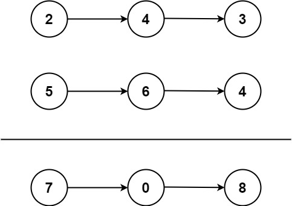

# 1. 两数之加

---

## 题目

给你两个**非空**的链表，表示两个非负的整数。它们每位数字都是按照**逆序**的方式存储的，并且每个节点只能存储**一位**数字。

请你将两个数相加，并以相同形式返回一个表示和的链表。

你可以假设除了数字 0 之外，这两个数都不会以 0 开头。

## 示例 
> [如何将非负整数用链表表示](../algorithm/src/com/cc/a002/Tools.java)

- 示例1:



  - 输入: l1 = [2,4,3], l2 = [5,6,4]
  - 输出: [7,0,8]
  - 解释: 因为 243 + 564 == 807 ，返回 [7, 0, 8] 。

- 示例2:

  - 输入: l1 = [0], l2 = [0]
  - 输出: [0]
  - 解释: 因为 0 + 0 == 0 ，返回 [0] 。

- 示例3:

  - 输入: l1 = [9,9,9,9,9,9,9], l2 = [9,9,9,9]
  - 输出: [8,9,9,9,0,0,0,1]
  - 解释: 因为 9999999 + 999 == 19999998 ，返回 [8, 9, 9, 9, 0, 0, 0, 1] 。

## 提示

- 每个链表的节点数在范围 [1, 100] 内
- 0 <= Node.val <= 9
- 除数字 0 之外，这两个数都不会以 0 开头

## 解题

### 方法一: 模拟

思路及算法:
> 由于两个链表已经按照逆序存储，因此从头节点开始，逐个相加即可。
> 
> 如果两个链表的当前节点都不存在且进位值为0，则结束循环。
> 如果两个链表的当前节点都不存在且进位值为1，则创建一个新的节点存储进位值1。

[代码:](../algorithm/src/com/cc/a002/Solution.java)
```java
public class Solution {
  public ListNode addTwoNumbers(ListNode l1, ListNode l2) {
    // 创建求和后的链表头节点
    ListNode head = null;
    // 创建求和后的链表尾节点
    ListNode tail = null;
    // 创建进位值，初始为0
    int carry = 0;
    while (l1 != null || l2 != null) {
      // 取出两个链表当前节点的值，如果节点为空则取0
      int n1 = l1 != null ? l1.val : 0;
      int n2 = l2 != null ? l2.val : 0;
      // 求和并加上进位值
      int sum = n1 + n2 + carry;
      // 计算进位值
      carry = sum / 10;
      // 创建新的节点，存储求和后的值
      ListNode node = new ListNode(sum % 10);
      // 如果是第一个节点，则设置头节点和尾节点
      if (head == null) {
        head = node;
        tail = node;
      } else { // 否则，将节点添加到链表尾部
        tail.next = node;
        tail = node;
      }
      // 移动到下一个节点
      if (l1 != null) l1 = l1.next;
      if (l2 != null) l2 = l2.next;
    }
    // 如果最后还有进位值，则创建一个新的节点存储进位值
    if (carry > 0) {
      tail.next = new ListNode(carry);
    }
    return head;
  }
}

```

- 时间复杂度：O(max(m, n))，其中 m 和 n 分别为两个链表的长度。
- 空间复杂度：O(max(m, n))
